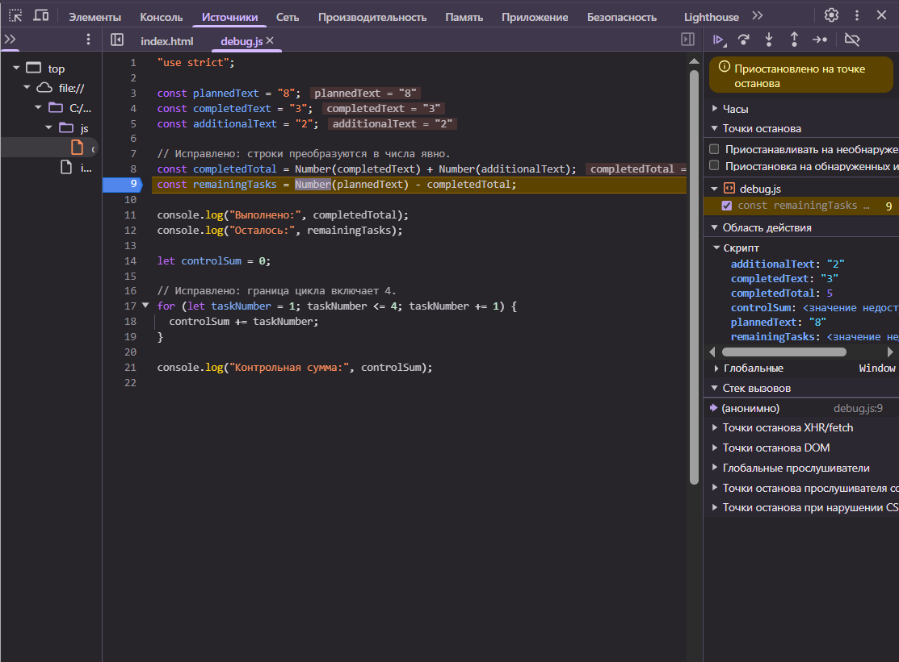

# Практическая работа № 1 — Подготовка окружения и первые программы на JavaScript

## 1. Автор и вариант

- ФИО: Рользинг Иван Викторович
- Группа: ЭФБО-13-25
- Вариант: 7 (номер в журнале N = 23, `((23 - 1) % 8) + 1 = 7`): totalTasks = 10, completedTasks = 7, dailyLimit = 3

## 2. Окружение

| Компонент | Версия / значение |
|---|---|
| ОС | Windows 10 Home 10.0.19045 |
| Node.js | v26.13.1 (установлен через winget; методичка рекомендует линейку 24 LTS, при необходимости заменить) |
| npm | 11.20.0 |
| Git | [заполнить `git --version`] |
| Браузер | [заполнить: Chrome или Edge; здесь проверялась логика во встроенном браузере] |

## 3. Инструкция по запуску

Команды выполняются из корня репозитория `tip-js-practices`:

```
node practice-01/js/hello.js
node practice-01/js/types.js
node practice-01/js/progress.js
node practice-01/js/plan.js
node practice-01/js/debug.js
```

В браузере: открыть `practice-01/index.html`, открыть DevTools → Консоль. Чтобы проверить другой файл, поменять `src` в `<script>` в `index.html` и обновить страницу.

## 4. Задание 1: hello.js

- Запуск в Node.js: выполнен, вывод: `Студент: Учебный студент`, `Группа: Учебная группа`, `Практическая работа: 1`, `JavaScript успешно запущен`, `Тип document: undefined`
- Запуск в браузере (Chrome, Консоль): тот же вывод, последняя строка `Тип document: object`. Скриншот: `screenshots/hello-browser-console.png`.
- Отличие: в браузере `typeof document` даёт `"object"`, в Node.js — `"undefined"`, потому что в Node.js нет DOM.

## 5. Задание 2: types.js

| № | Выражение | Ожидание | Фактическое значение | Тип результата | Объяснение |
|---|---|---|---|---|---|
| 1 | `"8" + 2` | `"82"` | `"82"` | string | `+` со строкой объединяет строки, число приводится к строке |
| 2 | `"8" - 2` | `6` | `6` | number | `-` приводит строку к числу |
| 3 | `Number("8") + 2` | `10` | `10` | number | Явное приведение, затем сложение чисел |
| 4 | `"12" > "3"` | `false` | `false` | boolean | Сравнение строк посимвольно: `"1" < "3"` |
| 5 | `12 === "12"` | `false` | `false` | boolean | Строгое сравнение не приводит типы |
| 6 | `Number("")` | `0` | `0` | number | Пустая строка становится нулём |
| 7 | `Number("text")` | `NaN` | `NaN` | number | Строка не число |
| 8 | `Boolean("false")` | `true` | `true` | boolean | Любая непустая строка истинна |
| 9 | `typeof null` | `"object"` | `"object"` | string | Историческая ошибка языка |
| 10 | `typeof NaN` | `"number"` | `"number"` | string | NaN имеет тип number |

Запуск `types.js` в Node.js выполнен, вывод совпадает с таблицей. Запуск в браузере [заполнить].

## 6. Задания 3–4: progress.js и plan.js

Проверки для варианта 1 (totalTasks = 12, completedTasks = 5, dailyLimit = 3). Основные вызовы (`progress.js`, `plan.js`) запущены в Node.js и дают ожидаемый вывод. Полный набор граничных проверок выполнен вычислением тех же функций в браузере; повтор в Node.js по каждой строке [заполнить].

| Проверка | Входные данные | Ожидаемый результат | Фактический результат | Итог |
|---|---|---|---|---|
| progress: вариант 7 | 10, 7 | Осталось 3; 70.0%; В работе | Осталось 3; 70.0%; В работе (Node.js) | Пройдено |
| progress: обычный случай (методичка) | 12, 5 | Осталось 7; 41.7%; В работе | Осталось 7; 41.7%; В работе | Пройдено |
| progress: ноль задач | 0, 0 | Задач пока нет | Задач пока нет | Пройдено |
| progress: ничего не сделано | 5, 0 | Осталось 5; 0.0%; Не начато | Осталось 5; 0.0%; Не начато | Пройдено |
| progress: всё сделано | 5, 5 | Осталось 0; 100.0%; Завершено | Осталось 0; 100.0%; Завершено | Пройдено |
| progress: выполнено больше | 5, 6 | Ошибка | Выполнено больше, чем всего задач | Пройдено |
| progress: отрицательное | -1, 0 | Ошибка | Не может быть отрицательным | Пройдено |
| progress: дробное | 5, 2.5 | Ошибка | Должно быть целым числом | Пройдено |
| progress: строка | "5", 2 | Ошибка | Должно быть числом | Пройдено |
| progress: выше лимита | 1001, 0 | Ошибка | Не может быть больше 1000 | Пройдено |
| progress: NaN | NaN, 0 | Ошибка | Должно быть целым числом | Пройдено |
| plan: вариант 7 | 10, 7, 3 | 1 день, 3 задачи | 1 день, выполнено 3 (Node.js) | Пройдено |
| plan: обычный случай (методичка) | 12, 5, 3 | 3 дня; последний день 1 | 3 дня; День 3: выполнено 1 | Пройдено |
| plan: два дня | 10, 4, 3 | 2 дня по 3 | 2 дня: 3 и 3 | Пройдено |
| plan: лимит больше остатка | 5, 3, 10 | 1 день, 2 задачи | 1 день, выполнено 2 | Пройдено |
| plan: всё сделано | 5, 5, 2 | 0 дней | Все задачи выполнены; 0 дней | Пройдено |
| plan: ноль задач | 0, 0, 2 | 0 дней | 0 дней | Пройдено |
| plan: лимит 0 | 5, 2, 0 | Ошибка | Лимит от 1 до 1000 | Пройдено |
| plan: лимит дробный | 5, 2, 1.5 | Ошибка | Лимит от 1 до 1000 | Пройдено |
| plan: неверные задачи | 5, 6, 2 | Ошибка | Некорректные значения задач | Пройдено |
| plan: лимит строкой | 5, 2, "2" | Ошибка | Лимит от 1 до 1000 | Пройдено |
| plan: лимит выше 1000 | 5, 2, 1001 | Ошибка | Лимит от 1 до 1000 | Пройдено |

Фактический вывод запусков для варианта 7 (Node.js v26.13.1):

`node practice-01/js/progress.js`:
```
Всего задач: 10
Выполнено: 7
Осталось: 3
Прогресс: 70.0%
Статус: В работе
```

`node practice-01/js/plan.js`:
```
Осталось задач: 3
День 1: выполнено 3, осталось 0
Потребуется дней: 1
```

Скриншоты результатов в Консоли: [заполнить: `screenshots/progress-run.png`, `screenshots/plan-run.png`, если преподаватель требует именно скриншоты].

## 7. Задание 5: отладка debug.js

| Ошибка | Что наблюдалось | Причина | Исправление | Результат после исправления |
|---|---|---|---|---|
| Обработка количества задач | `Выполнено: 32`, `Осталось: -24` | `+` склеивает строки, `-` работает с числами | `Number(...)` для каждого значения | `Выполнено: 5`, `Осталось: 3` |
| Граница цикла | `Контрольная сумма: 6` | `taskNumber < 4` не включает 4 | `taskNumber <= 4` | `Контрольная сумма: 10` |

Исходная версия сохранена в `debug-original.js`. Скриншот остановки на точке останова: `screenshots/debug-breakpoint.png`. На нём программа приостановлена на строке 9 (`const remainingTasks = ...`); в области действия видны `completedText: "3"` и `additionalText: "2"` (строки) и `completedTotal: 5` (число после явного `Number()`).



## 8. Вывод

Черновик (перепиши своими словами): Практика показала, что одни и те же данные могут вести себя по-разному в зависимости от типа. Строка `"8" - 2` даёт число, а `"8" + 2` даёт строку `"82"`: JavaScript приводит типы неявно, и без явного `Number()` легко получить неожиданный результат. Самой поучительной оказалась ошибка в `debug.js`: программа не падала, а выдавала неверные числа (`Выполнено: 32`, `Осталось: -24`). Без проверки значений по шагам её было бы трудно заметить. Ещё важно, что граница цикла `< 4` и `<= 4` отличается на одно значение, и это влияет на итоговую сумму.
