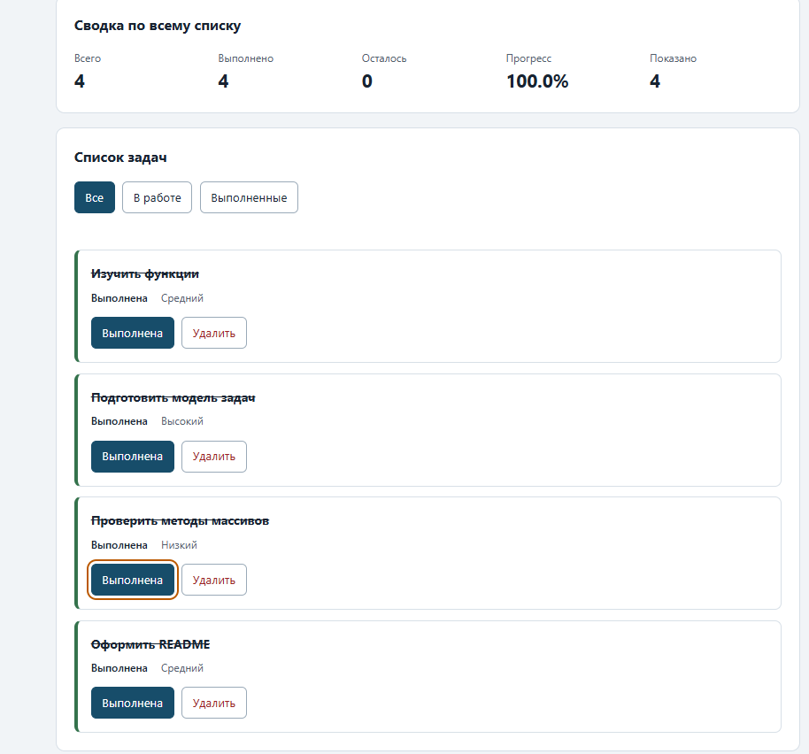
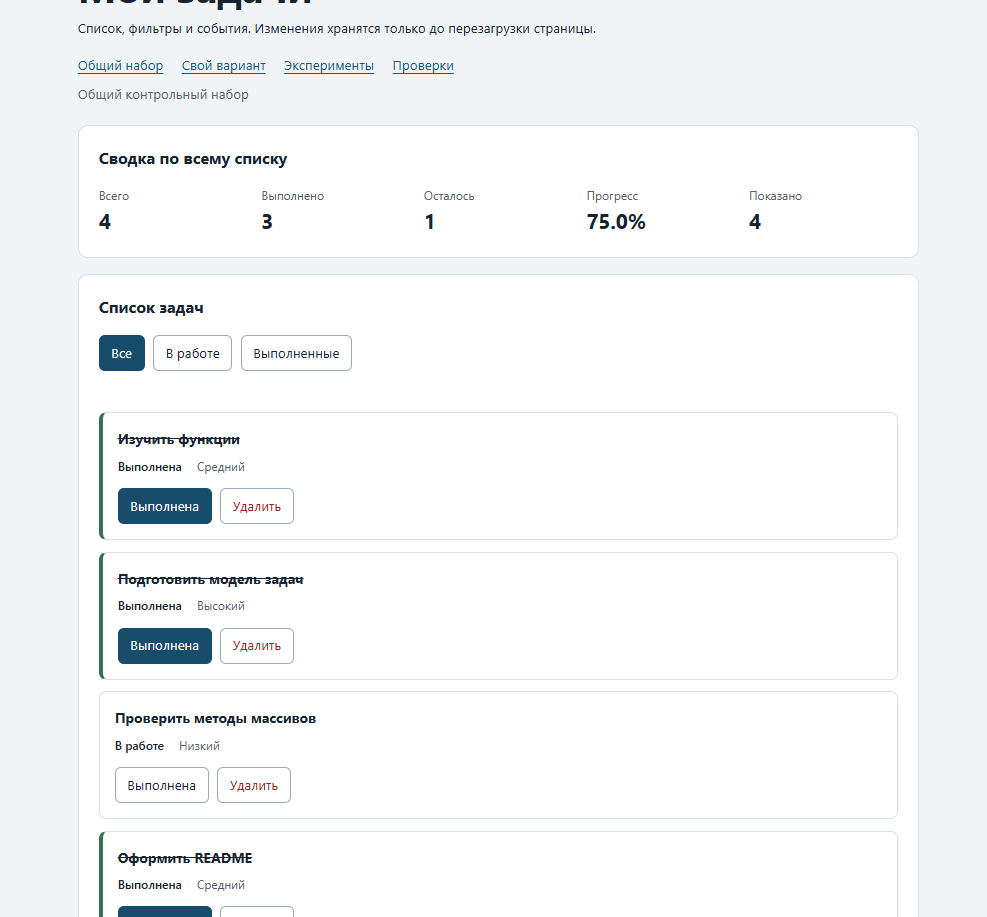

# Практическая работа № 3. Работа с DOM и событиями

## Данные работы

| Поле | Значение |
|---|---|
| Имя | Рользинг Иван Викторович |
| Группа | ЭФБО-13-25 |
| Вариант из ПР2 | 7 («Подготовка учебного релиза»), номер в журнале 23 |
| Node.js | v26.13.1 |
| Браузер | Google Chrome 157.0.8103.78 |
| Операционная система | Windows 10 Home 10.0.19045 |

## Запуск

Рабочая папка: `practice-03` внутри личного репозитория.

```bash
npm run check:service
npm start
```

Устанавливать зависимости через `npm install` не требуется. Для PowerShell при блокировке `npm.ps1` доступны `npm.cmd` и прямые команды `node`.

```text
http://127.0.0.1:5503/
http://127.0.0.1:5503/index.html?dataset=variant
http://127.0.0.1:5503/examples/dom-events.html
http://127.0.0.1:5503/checks.html
```

Остановка сервера: `Ctrl+C`. Порт 5503, другой порт не использовался.

## Что перенесено из ПР2

Файлы `src/task-service.js` и `src/data.js` перенесены без изменений из собственной работы `practice-02` (`practice-02/src/task-service.js` и `practice-02/src/data.js`). Повторная проверка 35 сценариев ПР2 в копии внутри ПР3 прошла (протокол ниже). Исправления в прежней реализации не потребовались.

## Эксперименты

| № | До запуска: прогноз | После запуска: результат | Объяснение |
|---:|---|---|---|
| 1. Отсутствующий элемент и коллекция | `querySelector` вернёт `null`, пустой `querySelectorAll` — коллекцию длиной 0; обращение к свойству `null` вызовет ошибку | `null`; длина `0`; `null.textContent` даёт `TypeError: Cannot read properties of null (reading 'textContent')` | При отсутствии совпадений `querySelector` возвращает `null`, а `querySelectorAll` — пустой `NodeList`. Свойства `null` читать нельзя, нужна проверка |
| 2. dataset и числовой id | `dataset.taskId` — строка `"23"`, после `Number` — число `23` | До: `"23"`, тип `string`. После: `23`, тип `number` | Значения `data-*` всегда строки. Для модели ПР2 нужно явное преобразование через `Number` |
| 3. Статический NodeList | После двух нажатий «Добавить запись» старый `NodeList` останется длиной 1, новый запрос покажет 3 | Старый `NodeList`: `1` (в Console дважды `Старый NodeList: 1`). Новый `querySelectorAll`: `3` | Результат `querySelectorAll` — снимок на момент вызова и не обновляется. Для актуального состояния нужен новый запрос |
| 4. Строка с HTML-разметкой | Заголовок покажет строку с угловыми скобками, элемент `strong` не создастся | Заголовок: `<strong>Это текст, а не HTML</strong>`, дочерних элементов `0` | `textContent` записывает строку как текст, не разбирает её как HTML |
| 5. Распространение события | Сначала фаза захвата на контейнере, затем всплытие: кнопка, затем контейнер; `target` везде вложенный `span` | `1. phase=1; target=lab-label; currentTarget=lab-card`, `2. phase=3; target=lab-label; currentTarget=lab-button`, `3. phase=3; target=lab-label; currentTarget=lab-card` | `target` — исходная цель (`span`), `currentTarget` — элемент, чей обработчик выполняется. Обработчик кнопки вызван при всплытии, потому что цель вложена в кнопку. Поэтому делегирование находит кнопку через `closest` |

## Организация кода

- `src/task-service.js` — функции ПР2 (поиск, сводка, изменение статуса, удаление). Не содержит `document`, кнопок и интерфейса.
- `src/data.js` — общий набор `demoTasks` и индивидуальный `variantTasks` (вариант 7).
- `src/task-selectors.js` — `getVisibleTasks(tasks, filter)`: новый массив по режимам `all`, `pending`, `completed`, порядок и объекты сохраняются.
- `src/task-view.js` — создание DOM: `createTaskElement`, `renderTaskList` (через `replaceChildren`), `renderSummary`, `renderEmptyState`. Состояние не изменяется, обработчики не назначаются. Названия выводятся через `textContent`.
- `src/main.js` — состояние и события.

Полный список хранится в `currentTasks`, выбранный фильтр — в `currentFilter`. Видимая выборка вычисляется в `renderApp` из этих двух значений и не записывается обратно. Обработчики назначены один раз на контейнеры `#task-list` и `#task-filters`; событие распознаётся через `closest`. Сводка считается через `getTaskStats(currentTasks)` по полному массиву, а «Показано» — по длине выборки.

## Общий сценарий

Ожидания находятся в разделе 6.5 методички. Ниже фактические результаты запуска (клики по настоящим элементам приложения).

| Шаг | Видимые id | Всего | Выполнено | Осталось | Прогресс | Показано | Сообщение | Совпало с ожиданием |
|---:|---|---|---|---|---|---|---|---|
| 0 | `[1, 4, 7, 10]` | 4 | 2 | 2 | 50.0% | 4 | | Да |
| 1 | `[4, 7]` | 4 | 2 | 2 | 50.0% | 2 | | Да |
| 2 | `[7]` | 4 | 3 | 1 | 75.0% | 1 | | Да |
| 3 | `[1, 4, 7, 10]` | 4 | 3 | 1 | 75.0% | 4 | | Да |
| 4 | `[1, 4, 10]` | 3 | 3 | 0 | 100.0% | 3 | | Да |
| 5 | `[]` | 3 | 3 | 0 | 100.0% | 0 | Нет задач по выбранному фильтру. | Да |
| 6 | `[1, 4, 10]` | 3 | 2 | 1 | 66.7% | 3 | | Да |
| 7 | `[]` | 0 | 0 | 0 | 0.0% | 0 | Список задач пуст. | Да |

После перезагрузки страницы возвращается шаг 0 (4 задачи, 50.0%): сохранение между перезагрузками в ПР3 не предусмотрено.

## Индивидуальный вариант

Вариант 7, тема «Подготовка учебного релиза». Исходные задачи: 11 «Собрать список изменений» (medium), 23 «Проверить сборку проекта» (high), 37 «Обновить инструкцию запуска» (low), 41 «Согласовать версию релиза» (medium), 58 «Подготовить заметки к выпуску» (low), 64 «Опубликовать учебный релиз» (high). Все шесть выполнены (K = 6).

| Этап | Всего | Выполнено | Осталось | Прогресс | Видимые id |
|---|---|---|---|---|---|
| До действий | 6 | 6 | 0 | 100.0% | `[11, 23, 37, 41, 58, 64]` |
| После переключения 23 | 6 | 5 | 1 | 83.3% | `[11, 23, 37, 41, 58, 64]` |
| После удаления 37 | 5 | 4 | 1 | 80.0% | `[11, 23, 41, 58, 64]` |
| Итог, фильтр «В работе» | 5 | 4 | 1 | 80.0% | `[23]` |
| Итог, фильтр «Выполненные» | 5 | 4 | 1 | 80.0% | `[11, 41, 58, 64]` |

До действий фильтр «В работе» показывает пустой результат с сообщением «Нет задач по выбранному фильтру.». Итоговый прогресс 80.0% и идентификаторы `[11, 23, 41, 58, 64]` совпадают с контрольными значениями методички.

## Протокол проверки сервиса

Команда: `npm run check:service` (Node.js v26.13.1).

```text
OK: 01. Создание задачи с явным приоритетом
OK: 02. Приоритет по умолчанию
OK: 03. Удаление краевых пробелов без изменения внутренних
OK: 04. Граничные длины названия и положительный безопасный id
OK: 05. Некорректные названия при создании
OK: 06. Некорректные идентификаторы при создании
OK: 07. Все допустимые приоритеты и отклонение недопустимых
OK: 08. Каждый вызов createTask возвращает новый объект
OK: 09. Поиск по id, а не по индексу
OK: 10. Отсутствующая задача и пустой массив при поиске
OK: 11. Поиск не преобразует строковый id в число
OK: 12. Получение невыполненных задач
OK: 13. Пустой список, все выполнены и все не выполнены
OK: 14. Названия в исходном порядке и пустой список
OK: 15. Сводка по общему набору
OK: 16. Сводка по пустому списку
OK: 17. Сводка: ничего не выполнено и выполнено всё
OK: 18. Процент остаётся числом без предварительного округления
OK: 19. Добавление в конец без изменения входного массива
OK: 20. Добавление в пустой список с приоритетом по умолчанию
OK: 21. Повторяющийся id отклоняется
OK: 22. Добавление не обходит проверки createTask
OK: 23. Изменение completed в обе стороны
OK: 24. completed принимает только boolean
OK: 25. Некорректный или отсутствующий id при изменении статуса
OK: 26. Повторная установка статуса создаёт новый результат
OK: 27. Переименование сохраняет остальные поля
OK: 28. Проверки названия при переименовании
OK: 29. Некорректный или отсутствующий id при переименовании
OK: 30. Удаление по id с сохранением порядка
OK: 31. Удаление единственной записи
OK: 32. Некорректный, отсутствующий id и удаление из пустого списка
OK: 33. Входные объекты не изменяются ни одной операцией
OK: 34. Общий сценарий и все промежуточные сводки
OK: 35. Работа с другим набором, без зависимости от demoTasks

Проверок пройдено: 35; не пройдено: 0.
```

## Протокол браузерных проверок

Текст из блока «Текстовый протокол» на `checks.html` (Chrome-совместимый встроенный браузер).

```text
OK: Фильтр all возвращает новый массив в исходном порядке
OK: Фильтр pending выбирает невыполненные задачи
OK: Фильтр completed выбирает выполненные задачи
OK: Все три фильтра работают с пустым списком
OK: Фильтрация не меняет входные записи и их порядок
OK: Карточка — li.task-card с числовым id в dataset
OK: Статус невыполненной карточки и aria-pressed согласованы
OK: Статус выполненной карточки и aria-pressed согласованы
OK: В карточке две обычные кнопки с вложенными подписями
OK: Все приоритеты отображаются по установленному словарю
OK: Название с разметкой отображается текстом
OK: Отрисовка списка создаёт карточки в исходном порядке
OK: Повторная отрисовка не накапливает карточки
OK: Контейнер списка и его обработчик сохраняются
OK: Отрисовка пустого массива очищает прежние карточки
OK: Сводка считается по всему списку, отдельно выводится Показано
OK: Пустая сводка не содержит NaN и Infinity
OK: Сообщение для полностью пустого списка
OK: Сообщение для пустого результата фильтра
OK: Появление карточек скрывает прежнее пустое состояние
OK: Приложение: начальный набор и сводка
OK: Приложение: фильтр срабатывает по клику на вложенный span
OK: Приложение: активный фильтр отмечен классом и aria-pressed
OK: Приложение: фильтрация не удаляет скрытые задачи
OK: Приложение: переключение по id, а не индексу массива
OK: Приложение: выполненная задача исчезает из фильтра В работе
OK: Приложение: удаление изменяет данные, а не только DOM
OK: Приложение: клик по названию не изменяет данные
OK: Приложение: после перерисовок одно нажатие — одно изменение
OK: Приложение: удаление всех записей и нулевая сводка
OK: Приложение: нет совпадений — не то же самое, что нет задач
OK: Приложение: неизвестный числовой id не меняет данные
OK: Приложение: id 4abc не превращается в 4
OK: Приложение: неизвестное действие игнорируется
OK: Приложение: после изменения сохраняется клавиатурный фокус
OK: Приложение: новая загрузка возвращает исходное состояние

Всего: 36. Пройдено: 36. Ошибок: 0.
```

## Собственные проверки

| № | Исходное состояние и действия | Ожидаемый результат | Фактический результат | Итог |
|---:|---|---|---|---|
| 1 (граничное состояние) | Общий набор; удалить id 1, 4, 10, останется одна задача 7; переключить её; открыть фильтры «В работе» и «Выполненные»; удалить 7; открыть «Выполненные» | Одна задача: `1\|0\|1\|0.0%`; после переключения `1\|1\|0\|100.0%`; «В работе» пусто с сообщением о фильтре; «Выполненные» показывают 7; после удаления `0\|0\|0\|0.0%` и сообщение «Список задач пуст.» для любого фильтра | Совпало: `1\|0\|1\|0.0%`, `1\|1\|0\|100.0%`, `[]` с «Нет задач по выбранному фильтру.», `[7]`, `0\|0\|0\|0.0%` и «Список задач пуст.» для «Выполненные» | Пройдено |
| 2 (события и перерисовка) | Общий набор; пять переключений фильтров (В работе, Выполненные, Все, В работе, Все); затем пять быстрых нажатий переключения id 4 | Нечётное число переключений: задача 4 выполнена, сводка `4\|3\|1\|75.0%`, карточек 4 (без дублей) | Статус задачи 4 «Выполнена», сводка `4\|3\|1\|75.0%\|4`, карточек 4 | Пройдено |
| 3 (неизменность набора) | Общий набор; удалить id 10; фильтр «В работе»; переключить 7; фильтр «Все»; сравнить экспортированный `demoTasks` с исходным | После действий в интерфейсе `[1, 4, 7]`, сводка `3\|3\|0\|100.0%`; экспортированный `demoTasks` не изменён | `[1, 4, 7]`, `3\|3\|0\|100.0%\|3`; `demoTasks` совпадает с исходным (4 записи) | Пройдено |

## Отладка и клавиатура

Точка останова: `src/main.js`, строка 61 (`const id = Number(card.dataset.taskId);`) в `handleTaskListClick`. Значения для нажатия на подпись кнопки «Выполнена» у задачи 4 (получены вызовом тех же функций в консоли браузера):

- `event.target` — вложенный `span.action-label`, `event.currentTarget` — `ul#task-list`;
- `dataset.taskId`: `"4"`, тип `string`; числовой `id`: `4`, тип `number`, `Number.isSafeInteger(id) && id > 0` — `true`;
- действие `toggle`; найденная запись: `{ id: 4, title: "Подготовить модель задач", completed: false, priority: "high" }`;
- результат `setTaskCompleted(tasks, 4, true)`: `ok: true`, новый массив (не тот же объект), у записи 4 `completed: true`.

Отказы: для `data-task-id="777"` сервис возвращает `{ ok: false, error: "Задача с id 777 не найдена" }`, сообщение выводится в `#operation-message`, данные не меняются. Для `"4abc"` `Number("4abc")` даёт `NaN`, а `parseInt("4abc")` дал бы `4` — поэтому используется `Number`; сообщение «Некорректный идентификатор задачи.», данные не меняются (автоматические проверки «неизвестный числовой id» и «id 4abc» пройдены).

Клавиатура: действия выполняются настоящими кнопками `<button type="button">`, поэтому Tab, Enter и Space работают штатно. Проверка сохранения фокуса после изменения статуса и удаления входит в автоматические проверки и пройдена: после действия фокус остаётся на той же кнопке той же задачи, а при её исчезновении переходит на активный фильтр. Ручная проверка в Chrome: клавишей Tab фокус переведён на кнопку «Выполнена» у задачи «Проверить методы массивов» (видна рамка фокуса), нажатие Enter изменило статус задачи на «Выполнена», сводка стала «Всего: 4 · Выполнено: 4 · Осталось: 0 · Прогресс: 100.0%». Скриншот: `screenshots/keyboard-focus.png`. Нажатие Space вручную отдельно не проверялось: для настоящих кнопок оно работает так же, как Enter.



## Вид приложения

Скриншот собственного запуска `http://127.0.0.1:5503/` после изменения статуса: сводка «Всего: 4 · Выполнено: 3 · Осталось: 1 · Прогресс: 75.0% · Показано: 4», фильтры «Все» / «В работе» / «Выполненные» и список карточек.



## Дополнительное задание

Дополнительное задание не выполнялось.

## Вывод

К функциям из ПР2 подключён браузерный интерфейс: отображение списка, фильтры, смена статуса и удаление. Данные хранятся в массиве currentTasks, а страница их отображает; удаление DOM-узла без изменения данных не удаляет задачу, а фильтр меняет только выборку. Идентификатор из dataset преобразуется в число через Number; события обрабатываются одним обработчиком на контейнере с поиском кнопки через closest. Все проверки (35 и 36) проходят.
