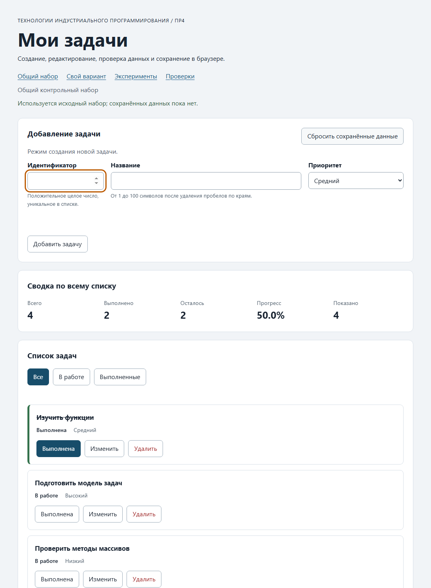

# Практическая работа № 4. Формы, валидация и локальное хранение данных

## Данные работы

| Поле | Значение |
|---|---|
| Имя | Рользинг Иван Викторович |
| Группа | ЭФБО-13-25 |
| Вариант из ПР2–ПР3 | 7 («Подготовка учебного релиза»), номер в журнале 23 |
| Node.js | v26.13.1 |
| Браузер | Chromium (встроенный браузер, ручные проверки); скриншот снят в Google Chrome 157.0.8103.78 |
| Операционная система | Windows 10 Home 10.0.19045 |

## Запуск

Рабочая папка: `practice-04` внутри личного репозитория.

```bash
npm test
npm start
```

Устанавливать зависимости через `npm install` не требуется.

```text
http://127.0.0.1:5504/
http://127.0.0.1:5504/index.html?dataset=variant
http://127.0.0.1:5504/examples/forms-storage.html
http://127.0.0.1:5504/checks.html
```

Использован порт 5504 (по умолчанию). Для всех проверок сохранялся один адрес, чтобы не менять origin и область `localStorage`.

## Перенос результата ПР3

Перенесены собственные проверенные модули из `practice-03`. Повторная проверка сервиса в ПР4 дала 35 пройденных сценариев и 0 ошибок (протокол ниже).

| Файл | Что перенесено или изменено |
|---|---|
| `data.js` | Перенесён без изменений: общий `demoTasks` и данные варианта 7 (`variantNumber = 7`, шесть задач) |
| `task-service.js` | Перенесён из ПР3 (функции ПР2) и добавлена `updateTask(tasks, id, title, priority)`: меняет только `title` и `priority`, сохраняет `id` и `completed`, не изменяет входной массив |
| `task-selectors.js` | Перенесён без изменений (`getVisibleTasks`) |
| `task-view.js` | Перенесён и добавлена третья кнопка `edit` («Изменить») между `toggle` и `delete`; название по-прежнему выводится через `textContent` |

## Эксперименты с формой и хранилищем

Страница `examples/forms-storage.html`. Фактические значения получены запуском тех же действий на странице.

| № | До запуска: прогноз | После запуска: результат | Объяснение |
|---|---|---|---|
| 1. Пустое обязательное поле | Браузер не даст отправить форму, `submit` не возникнет, `valid = false`, стандартное сообщение | События `submit` нет (0); `validity.valid = false`, `valueMissing = true`; сообщение «Заполните это поле.»; журнал не изменился | Нативная проверка `required` срабатывает до обработчика `submit`, поэтому код обработчика не вызывается |
| 2. Название из пробелов | `required` пропустит пробелы, обработчик получит `submit`, а `setCustomValidity` отклонит значение | До отправки `valid = true`, `valueMissing = false`; `submit` получен (1); `customError = true`, сообщение «Название не должно состоять только из пробелов.»; после ввода символа `setCustomValidity("")` снимает ошибку (`valid = true`) | `required` проверяет только непустую строку, но не смысл значения. Прикладное правило с `trim()` и `setCustomValidity` нужно, а сообщение обязательно сбрасывать на `input` |
| 3. Типы значений `FormData` | Значения — строки, `defaultPrevented = true`, название без краевых пробелов | `submit.defaultPrevented: true`, `typeof FormData title: string`, значение `{ "title": "Изучить формы", "priority": "high" }` | `FormData` возвращает строки; `preventDefault` отменяет стандартную отправку, а обработка продолжается |
| 4. Строка в `localStorage` и JSON | `getItem` вернёт строку JSON, `JSON.parse` восстановит объект | Тип результата `getItem`: `string`; `raw` `{"title":"Изучить формы","priority":"high"}`; `parsed` — объект с теми же полями | `localStorage` хранит только строки: объект нужно сериализовать `JSON.stringify` и разобрать `JSON.parse` |
| 5. Повреждённый JSON | `JSON.parse` выбросит исключение | `JSON.parse завершился ошибкой: Expected property name or '}' in JSON at position 1 (line 1 column 2)`; в `raw` осталась строка `{broken-json` | Чтение сохранённых данных нужно оборачивать в `try/catch`: строка в хранилище может быть любой |

## Организация кода

- `task-service.js` — прикладные операции над массивом задач (поиск, фильтр, сводка, `addTask`, `setTaskCompleted`, `updateTask`, `removeTask`). Не содержит `document`, полей формы и `localStorage`; входные данные не изменяются.
- `form-validation.js` — чистая функция `validateTaskDraft(draft, tasks, editingId)`: нормализует `id` (через `Number`, пустая строка и `"4abc"` отклоняются), `title` (`trim`, длина 1–100), проверяет приоритет и уникальность `id`. В режиме редактирования источником `id` служит `editingId`. DOM и показ ошибок остаются в `main.js`.
- `task-storage.js` — граница `localStorage`: `isValidTaskList`, `loadTasks`, `saveTasks`, `removeSavedTasks`. Исключения перехватываются, возвращаются `{ ok, ... }`. Данные читаются и пишутся в оболочке `{ version: 1, tasks }`.
- `task-view.js` — создание карточек, списка, сводки и пустого состояния; обработчиков и записи JSON нет.
- `main.js` — состояние (`currentTasks`, `currentFilter`, `editingId`), режим формы, события, вызовы сервиса, сохранения и отрисовки.

Функции хранения получают объект `storage` аргументом, чтобы проверять модуль на имитации без глобального `localStorage` и явно показать внешнюю зависимость. Данные из JSON проверяются до использования, потому что успешный `JSON.parse` подтверждает только синтаксис: в записи может оказаться другая версия, неверные типы или повторяющиеся `id`. Повреждённая запись целиком отклоняется, используется копия исходного набора.

## Проверка формы

| Сценарий | Ожидаемый результат | Фактический результат | Итог |
|---|---|---|---|
| Добавление корректной задачи | Задача добавлена, сохранена | `id = 20`, «Изучить localStorage», `high`: список `[1, 4, 7, 10, 20]`, 5 задач, запись в `localStorage` появилась | Пройдено |
| Повторяющийся id | Отказ без изменения списка | Ошибка у поля id «Задача с таким идентификатором уже существует.»; список и JSON в `localStorage` не изменились | Пройдено |
| Пустое название | Отказ | Нативная проверка `required` блокирует отправку (проверка 11 в `checks.html` и эксперимент 1) | Пройдено |
| Название из пробелов | Отказ прикладной проверки | Отклоняется `validateTaskDraft` (проверки модулей 09 и браузерная «Название из пробелов отклоняется прикладной проверкой») | Пройдено |
| Название длиной 100 | Успех | Задача `id = 30` добавлена, длина названия 100 | Пройдено |
| Название длиной 101 | Отказ | Ошибка «Название должно содержать от 1 до 100 символов.», задача не добавлена, сводка прежняя | Пройдено |
| Редактирование title и priority | Меняется одна задача, статус сохраняется | Для `id = 4`: «Подготовить форму задач», «Низкий», статус «В работе» сохранён; поле id заблокировано, кнопка «Сохранить изменения» | Пройдено |
| Отмена редактирования | Возврат к пустой форме создания | Проверка «Отмена редактирования возвращает режим создания» пройдена: id разблокирован, кнопка «Добавить задачу», отмена скрыта | Пройдено |

## Общий сценарий

Фактические результаты последовательности из раздела 6.8 методички (клики и ввод в настоящем интерфейсе; шаг 6 выполнен перезагрузкой страницы).

| Шаг | Действие | Видимые id | Всего | Выполнено | Осталось | Прогресс | Состояние storage |
|---:|---|---|---:|---:|---:|---:|---|
| 0 | Исходный запуск после сброса | `[1, 4, 7, 10]` | 4 | 2 | 2 | 50.0% | Ключ отсутствует |
| 1 | Добавление `id = 20` | `[1, 4, 7, 10, 20]` | 5 | 2 | 3 | 40.0% | Запись создана, версия 1, 5 задач |
| 2 | Отказ для повторного `id = 4` | `[1, 4, 7, 10, 20]` | 5 | 2 | 3 | 40.0% | JSON не изменился, ошибка у поля id |
| 3 | Редактирование `id = 4` («Подготовить форму задач», `low`) | `[1, 4, 7, 10, 20]` | 5 | 2 | 3 | 40.0% | Сохранено; статус задачи 4 остался `false` |
| 4 | Переключение `id = 7` | `[1, 4, 7, 10, 20]` | 5 | 3 | 2 | 60.0% | Сохранено |
| 5 | Удаление `id = 1` | `[4, 7, 10, 20]` | 4 | 2 | 2 | 50.0% | Сохранено |
| 6 | Перезагрузка страницы | `[4, 7, 10, 20]` | 4 | 2 | 2 | 50.0% | «Данные восстановлены из localStorage.» |
| 7 | Сброс данных | `[1, 4, 7, 10]` | 4 | 2 | 2 | 50.0% | Ключ `tip-js-practice-04:demo` отсутствует |

Повреждённый JSON: в ключ `tip-js-practice-04:demo` записана строка `{broken-json`, после перезагрузки приложение открылось с исходным набором `[1, 4, 7, 10]` (4, 2, 2, 50.0%), статус содержал предупреждение «Сохранённые данные повреждены (некорректный JSON). Используется исходный набор.», повреждённая запись осталась в хранилище. После сброса ключ удалён.

## Проверка восстановления и ошибок

| Случай | Ожидание | Фактический результат | Итог |
|---|---|---|---|
| Записи нет | Используется независимая копия исходного набора | После сброса: исходный набор, «Используется исходный набор…», ключа нет; проверки модулей 16 и 27 | Пройдено |
| Корректная запись | Данные восстанавливаются после перезагрузки | Шаг 6: `[4, 7, 10, 20]`, сообщение о восстановлении | Пройдено |
| Повреждённый JSON | Исходный набор и предупреждение | Исходный набор, предупреждение, статус с классом `is-warning` | Пройдено |
| Неверная версия или схема | Исходный набор и предупреждение | В запись записано `completed: "нет"`: приложение открылось с `[1, 4, 7, 10]` и предупреждением «Сохранённые задачи не соответствуют схеме. Используется исходный набор.» | Пройдено |
| Сброс | Удаляется только ключ текущего набора | После сброса ключ текущего набора отсутствует; ключ другого набора не затрагивается (проверки модуля 25 и браузерная «Общий и индивидуальный наборы…») | Пройдено |
| Общий и индивидуальный наборы | Изменения не смешиваются | Изменения варианта 7 не появились в общем наборе: ключ `demo` оставался `null` | Пройдено |

## Индивидуальный вариант

Вариант 7, «Подготовка учебного релиза». Исходные задачи: 11 «Собрать список изменений» (`medium`), 23 «Проверить сборку проекта» (`high`), 37 «Обновить инструкцию запуска» (`low`), 41 «Согласовать версию релиза» (`medium`), 58 «Подготовить заметки к выпуску» (`low`), 64 «Опубликовать учебный релиз» (`high`); все выполнены.

| Этап | Всего | Выполнено | Осталось | Прогресс | Видимые id |
|---|---:|---:|---:|---:|---|
| Исходный набор | 6 | 6 | 0 | 100.0% | `[11, 23, 37, 41, 58, 64]` |
| После добавления `75` («Подготовить заметки о релизе для команды», `medium`) | 7 | 6 | 1 | 85.7% | `[11, 23, 37, 41, 58, 64, 75]` |
| После редактирования `23` («Проверить сборку проекта и зафиксировать версию», `high`) | 7 | 6 | 1 | 85.7% | `[11, 23, 37, 41, 58, 64, 75]` |
| После удаления `37` | 6 | 5 | 1 | 83.3% | `[11, 23, 41, 58, 64, 75]` |
| После перезагрузки | 6 | 5 | 1 | 83.3% | `[11, 23, 41, 58, 64, 75]` |
| После сброса | 6 | 6 | 0 | 100.0% | `[11, 23, 37, 41, 58, 64]` |

Новая задача `75` не выполнена (статус «В работе»); статус задачи `23` («Выполнена») после редактирования сохранился. Итоговый прогресс 83.3% совпадает с контрольным значением методички для варианта 7. После изменений варианта ключ общего набора оставался `null`, ключ варианта после сброса удалён.

## Протокол проверок сервиса

Команда: `npm run check:service` (Node.js v26.13.1).

```text
OK: 01. Создание задачи с явным приоритетом
OK: 02. Приоритет по умолчанию
OK: 03. Удаление краевых пробелов без изменения внутренних
OK: 04. Граничные длины названия и положительный безопасный id
OK: 05. Некорректные названия при создании
OK: 06. Некорректные идентификаторы при создании
OK: 07. Все допустимые приоритеты и отклонение недопустимых
OK: 08. Каждый вызов createTask возвращает новый объект
OK: 09. Поиск по id, а не по индексу
OK: 10. Отсутствующая задача и пустой массив при поиске
OK: 11. Поиск не преобразует строковый id в число
OK: 12. Получение невыполненных задач
OK: 13. Пустой список, все выполнены и все не выполнены
OK: 14. Названия в исходном порядке и пустой список
OK: 15. Сводка по общему набору
OK: 16. Сводка по пустому списку
OK: 17. Сводка: ничего не выполнено и выполнено всё
OK: 18. Процент остаётся числом без предварительного округления
OK: 19. Добавление в конец без изменения входного массива
OK: 20. Добавление в пустой список с приоритетом по умолчанию
OK: 21. Повторяющийся id отклоняется
OK: 22. Добавление не обходит проверки createTask
OK: 23. Изменение completed в обе стороны
OK: 24. completed принимает только boolean
OK: 25. Некорректный или отсутствующий id при изменении статуса
OK: 26. Повторная установка статуса создаёт новый результат
OK: 27. Переименование сохраняет остальные поля
OK: 28. Проверки названия при переименовании
OK: 29. Некорректный или отсутствующий id при переименовании
OK: 30. Удаление по id с сохранением порядка
OK: 31. Удаление единственной записи
OK: 32. Некорректный, отсутствующий id и удаление из пустого списка
OK: 33. Входные объекты не изменяются ни одной операцией
OK: 34. Общий сценарий и все промежуточные сводки
OK: 35. Работа с другим набором, без зависимости от demoTasks

Проверок пройдено: 35; не пройдено: 0.
```

## Протокол проверок новых модулей

Команда: `npm run check:modules`.

```text
OK: 01. updateTask изменяет название и приоритет выбранной задачи
OK: 02. updateTask нормализует название и сохраняет completed
OK: 03. updateTask не изменяет входной массив и объекты
OK: 04. updateTask отклоняет некорректный и отсутствующий id
OK: 05. updateTask отклоняет некорректные название и приоритет
OK: 06. Валидация создания нормализует поля
OK: 07. Валидация отклоняет некорректные id
OK: 08. Валидация отклоняет повторяющийся id при создании
OK: 09. Валидация проверяет название после trim
OK: 10. Валидация принимает только три приоритета
OK: 11. В режиме редактирования используется editingId
OK: 12. Редактирование отсутствующей задачи отклоняется
OK: 13. Валидация не изменяет draft и список
OK: 14. Проверка схемы принимает корректный список
OK: 15. Проверка схемы отклоняет неверную структуру
OK: 16. Отсутствующая запись возвращает независимую копию исходных данных
OK: 17. Корректная запись восстанавливается из хранилища
OK: 18. Повреждённый JSON приводит к безопасному fallback
OK: 19. Неизвестная версия приводит к безопасному fallback
OK: 20. Некорректные задачи из JSON не принимаются
OK: 21. Ошибка getItem перехватывается
OK: 22. Сохранение записывает версию и задачи
OK: 23. Некорректный список не записывается
OK: 24. Ошибка setItem перехватывается
OK: 25. Удаляется только переданный ключ
OK: 26. Ошибка removeItem перехватывается
OK: 27. Результат загрузки не разделяет объекты с fallback

Проверок пройдено: 27; не пройдено: 0.
```

## Протокол браузерных проверок

Текст из блока «Текстовый протокол» на `checks.html`.

```text
OK: Фильтры ПР3 сохраняют порядок и не изменяют вход
OK: Карточка содержит toggle, edit и delete
OK: Название задачи выводится как текст
OK: Повторная отрисовка списка не накапливает карточки
OK: Сводка использует полный список и отдельный visibleCount
OK: Пустые состояния различают список и фильтр
OK: Приложение запускается с исходным набором
OK: Корректная форма добавляет задачу и сохраняет данные
OK: Повторяющийся id отклоняется без записи
OK: Название из пробелов отклоняется прикладной проверкой
OK: Нативные ограничения не пропускают пустую форму
OK: Кнопка edit заполняет форму и блокирует id
OK: Редактирование меняет title и priority, сохраняя completed
OK: Отмена редактирования возвращает режим создания
OK: Успешная отправка очищает ошибки и форму
OK: Изменение статуса сохраняется
OK: Удаление сохраняется
OK: Фильтр не записывается, но сохраняется после изменения данных
OK: Перезагрузка восстанавливает сохранённые задачи
OK: Сброс удаляет ключ и восстанавливает исходный набор
OK: Повреждённый JSON не ломает запуск
OK: Некорректная схема из storage заменяется исходным набором
OK: Общий и индивидуальный наборы используют разные ключи

Всего: 23. Пройдено: 23. Ошибок: 0.
```

## Собственные проверки

| № | Исходное состояние и действия | Ожидаемый результат | Фактический результат | Итог |
|---:|---|---|---|---|
| 1 (граница формы) | После сброса: добавить `id = 30` с названием из 100 символов; затем `id = 31` с названием из 101 символа (значение задано программно, в обход `maxlength`) | 100 символов принимается, 101 отклоняется с ошибкой у поля названия, список не меняется | `id = 30` добавлен (длина 100); для 101 ошибка «Название должно содержать от 1 до 100 символов.», задача не добавлена, сводка осталась `5\|2\|3\|40.0%` | Пройдено |
| 2 (восстановление) | Поле id: ввод `4abc` в `type="number"`; затем переключить `id = 4`, удалить `id = 10`, выбрать фильтр «Выполненные», перезагрузить страницу | Браузер не принимает `4abc` в числовом поле; после перезагрузки данные восстановлены, а фильтр сброшен на «Все» | Браузер оставил поле пустым (`valueMissing = true`, «Заполните это поле.»); после перезагрузки `[1, 4, 7, 30]`, 4 / 2 / 2 / 50.0%, «Данные восстановлены из localStorage.», активный фильтр «Все» | Пройдено |
| 3 (сбой хранилища) | Имитировать исключение `setItem` (`QuotaExceededError`) и добавить `id = 40` | Задача остаётся в памяти вкладки, показывается предупреждение о потере после перезагрузки, в хранилище запись не появляется | Список `[1, 4, 7, 30, 40]`, статус с классом `is-warning`: «Не удалось записать в localStorage: QuotaExceededError (имитация). После перезагрузки изменения могут быть потеряны.»; в сохранённом JSON `id = 40` нет | Пройдено |

Строка `4abc` отклоняется уже на уровне поля `type="number"`, а чистая функция `validateTaskDraft` отдельно отклоняет `"4abc"`, `""`, `"1.5"`, `"0"` и `"-1"` (проверка модулей 07).

## Отладка и клавиатура

Точка останова: `src/main.js`, строка 189 (`const checked = validateTaskDraft(draft, currentTasks, editingId);`) в `handleFormSubmit`. Значения для добавления `id = 20` (получены при запуске сценария):

- сырой `draft`: `{ id: "20", title: "Изучить localStorage", priority: "high" }` — все значения строки, поле id приходит строкой;
- результат `validateTaskDraft`: `{ ok: true, value: { id: 20, title: "Изучить localStorage", priority: "high" } }` — `id` преобразован в число;
- результат `addTask`: `ok: true`, новый массив из 5 записей;
- записанная строка JSON: `{"version":1,"tasks":[...пять задач, последняя {"id":20,"title":"Изучить localStorage","completed":false,"priority":"high"}...]}`.

Ошибочный сценарий (повторный `id = 4`): `validateTaskDraft` вернул `{ ok: false, errors: { id: "Задача с таким идентификатором уже существует." } }`, `addTask` не вызывался, `saveTasks` не вызывался, JSON в `localStorage` остался прежним.

Клавиатура: форма отправляется через `submit`, поэтому Enter в поле работает штатно; все действия карточек выполняются настоящими кнопками `<button type="button">`, поэтому Tab, Enter и Space доступны. При начале редактирования фокус переходит на поле названия, при отмене и после успешной отправки — на поле id; после `toggle` и `delete` фокус возвращает `restoreTaskFocus`. Ручная проверка с клавиатуры: поле id (ввод `60`), Tab, поле названия (ввод «Add task with keyboard»), Tab, Tab (приоритет) до кнопки «Добавить задачу» (фокус подтверждён), Enter: задача создана и сохранена («Изменения сохранены в localStorage.»), в списке id `[1, 4, 7, 10, 60]`, сводка 5 / 2 / 3 / 40.0%. Space на кнопках отдельно не проверялся: для настоящих `<button>` он работает как Enter.

## Вид приложения

Скриншот собственного запуска `http://127.0.0.1:5504/` (исходный набор: форма добавления с рамкой фокуса в поле id, сводка «Всего 4, Выполнено 2, Осталось 2, Прогресс 50.0%», список задач с кнопками «Выполнена», «Изменить», «Удалить»).



## Дополнительное задание

Дополнительное задание не выполнялось.

## Вывод

Добавлены форма создания и редактирования и сохранение в localStorage. Используются три уровня проверки: нативные ограничения HTML, прикладная валидация (	rim, уникальность id, приоритет) и проверка данных после чтения из хранилища (версия и схема). Заблокированное поле id не попадает в FormData, поэтому при редактировании используется editingId. При повреждённых данных используется копия исходного набора и показывается предупреждение. Все проверки (35, 27 и 23) проходят.
